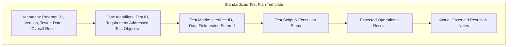
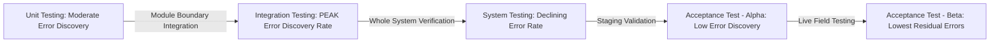
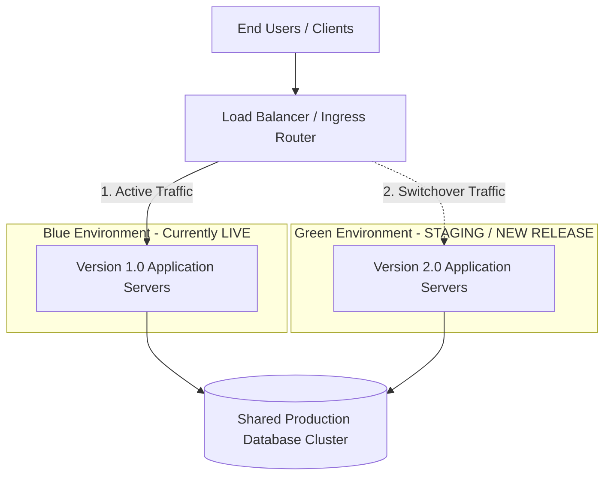
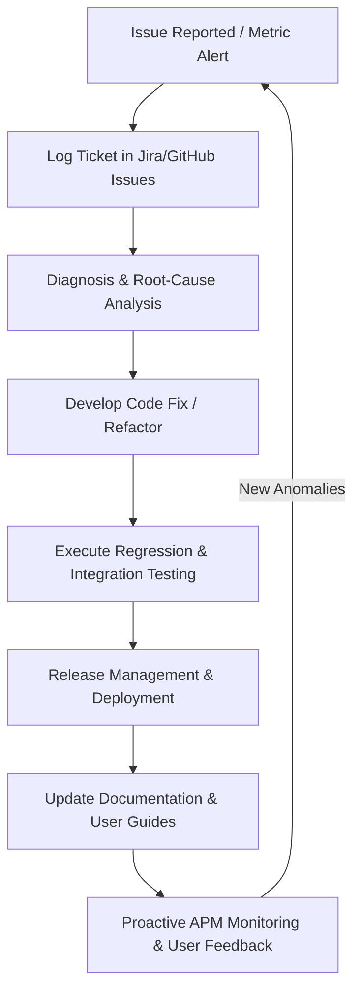

# System Analysis, Design, Testing, Maintenance, Governance, Security, and Ethics: A Comprehensive Academic Source Document

**Course Title:** System Analysis & Design (CSE 0613-3109)  
**Institution:** Department of Computer Science & Engineering (CSE), Khwaja Yunus Ali University (KYAU)  
**Instructor:** Mst Anika Amzad, Lecturer, Department of CSE, KYAU  
**Consolidated Source Material:** 
- *Lecture 9: System or Prototype Testing, Development and Deployment Issues* (`Lecture9_System or Protype Testing,Development and deployment Issues.pptx`)
- *Lecture 10: Information System Maintenance/Governance, Security and Ethics* (`Lecture10_Information system maintenance or governance ,security and ethics.pptx`)

---

## 1. Executive Summary and Academic Introduction

In modern software engineering and Information Systems (IS) development, the operational phase of a system's lifecycle accounts for over 70% of total lifetime costs and determines long-term organizational viability. This comprehensive source document synthesizes the foundational, operational, and ethical principles of Information Systems engineering as presented in Lectures 9 and 10 of the *System Analysis & Design* curriculum.

The lifecycle continuum spans seven interconnected domains:
1. **System/Prototype Testing**: Rigorous evaluation methodologies to ensure functional correctness, performance, and compliance prior to operational deployment.
2. **Integration Testing Approaches**: Architectural strategies (Big Bang, Top-Down, Bottom-Up, Incremental) to catch interface defects at module boundaries.
3. **Software Development Life Cycle (SDLC) Execution**: Systematic packaging, building, and staging protocols alongside resource and scope management.
4. **Deployment Strategies**: Operational deployment patterns (Recreate, Rolling, Blue-Green, Canary, A/B Testing, Shadow, Feature Toggles) designed to balance system availability, risk, and deployment speed.
5. **System Maintenance Frameworks**: Post-deployment workflows categorized into Corrective, Preventive, Adaptive, and Perfective maintenance to ensure longevity.
6. **Information System Governance**: Strategic alignment, risk management, and regulatory compliance enforced through COBIT, ITIL, ISO/IEC 38500, and NIST frameworks.
7. **Security and Ethics**: Safeguarding data confidentiality, integrity, and availability (CIA Triad) while ensuring algorithmic fairness, data privacy, and ethical technology governance.

---

## 2. Topic-Wise Consolidated Content

### Part I: System and Prototype Testing Fundamentals

#### 1. Definition and Objectives of Testing
System or Prototype Testing is the formal process of evaluating a complete, integrated software system or working prototype to ensure that it satisfies specified business and technical requirements and operates reliably under real-world conditions [`Lecture 9, Slide 4`].

The primary objectives of testing include:
* **End-to-End Verification**: Validating complete workflows from input to output across all system layers [`Lecture 9, Slide 4`].
* **Defect Identification**: Isolating bugs, faults, and performance bottlenecks before production release [`Lecture 9, Slide 4`].
* **Requirement Compliance**: Ensuring strict alignment with functional and non-functional specifications [`Lecture 9, Slide 4`].
* **Operational Evaluation**: Assessing responsiveness, stability, reliability, and scalability under varying loads [`Lecture 9, Slide 4`].

#### 2. Defect Taxonomy and Terminology
To maintain rigor in software quality assurance, three distinct terms must be differentiated [`Lecture 9, Slide 4`]:
* **Error**: A human mistake made by a software developer, analyst, or designer during coding, design, or specification (e.g., a logic flaw or syntax error).
* **Bug**: An unwanted flaw, fault, or failure in a software program that occurs during test execution as a consequence of an underlying error.
* **Defect**: A documented deviation between the actual system behavior and the expected specification/requirements.

#### 3. Strategic Importance of Quality Assurance
Investing in structured testing yields four major organizational benefits [`Lecture 9, Slides 5`]:
1. **Early Defect Identification**: Catching defects early in the SDLC dramatically reduces remediation costs (exponential cost curve of bug fixing).
2. **Customer Satisfaction & Support Cost Reduction**: Delivering software that fulfills user expectations reduces support desk volume and long-term maintenance overhead.
3. **Brand Reputation & Trust**: High software reliability builds organizational credibility and user retention.
4. **Compliance & Threat Safeguarding**: Rigorous testing verifies compliance with legal standards and hardens software against cybersecurity vulnerabilities.

#### 4. System Testing Taxonomy
Testing spans multiple complementary operational levels [`Lecture 9, Slides 6, 32-33`]:
* **Unit Testing**: Isolated verification of individual routines, classes, or modules independently.
* **Integration Testing**: Verification of inter-module data flow, interface agreements, and communication protocols.
* **System Testing**: End-to-end evaluation of the entire integrated application as a single entity.
* **Acceptance Testing**: Final validation (Alpha/Beta) conducted to determine whether the system fulfills business requirements for formal sign-off.
* **Regression Testing**: Re-executing test suites following code modifications to confirm existing functionalities remain uncorrupted.
* **Performance Testing**: Evaluating system responsiveness, throughput, and stability under load (Stress, Load, Endurance testing).
* **Security Testing**: Assessing the system's resistance to unauthorized access, data breaches, and malicious exploits.

#### 5. Standardized Testing Plan Artifact
A formal Test Plan document establishes structure and accountability during test execution [`Lecture 9, Slide 7`]. The standard template structure includes:
* **Document Metadata**: Program ID, Version Number, Tester Name, Date Designed, Date Conducted, Overall Status (Passed / Open Items), Page Number.
* **Case Identifiers**: Test ID, Requirement Addressed, Test Objective.
* **Test Matrix**: Interface ID, Data Field Name, Value Entered (Grid supporting multiple test iterations).
* **Execution Logs**: Execution Script, Expected Results / Operational Notes, Actual Observed Results / Deviation Notes.

#### 6. Operational Challenges in Testing
Testing teams frequently encounter five systemic hurdles [`Lecture 9, Slide 36`]:
* **System Complexity**: Complex interdependencies make isolation of root causes difficult.
* **Resource Constraints**: Tight release schedules, restricted budgets, and shortages of skilled test engineers.
* **Requirement Volatility**: Rapidly changing user requirements invalidate existing test cases.
* **Tool and Technology Selection**: Difficulty selecting optimal automation frameworks from a fragmented vendor ecosystem.
* **Cross-Functional Communication Breakdown**: Siloed communication between development, QA, and business stakeholders.

---

### Part II: Integration Testing Methodologies and Architectural Approaches

#### 1. Concept and Rationale
Integration testing focuses explicitly on the interaction between software modules rather than the internal logic of individual modules [`Lecture 9, Slide 39`]. It identifies flaws in API contracts, parameter passing, data transformations, and database interactions across module boundaries.

#### 2. Domain Examples
* **E-Commerce System**: Verifying interaction between User Authentication, Product Catalog, Shopping Cart, and Payment Gateway modules during checkout [`Lecture 9, Slide 40`].
* **Core Banking Platform**: Validating synchronized updates across Account Management, Transaction Processing, and Customer Service tools when a transfer is executed [`Lecture 9, Slide 40`].

#### 3. Architectural Integration Strategies
Four primary architectural approaches govern module combination [`Lecture 9, Slides 41-42`]:
1. **Big Bang Integration**: All modules are combined simultaneously and tested as a single lump.
   * *Characteristics*: High risk, difficult defect isolation, no need for test double harnesses.
2. **Top-Down Integration**: Testing originates at high-level control modules and navigates downward.
   * *Harness Requirement*: Lower-level unbuilt modules are replaced by **Stubs** (dummy code blocks that simulate module response).
3. **Bottom-Up Integration**: Testing begins at atomic, utility-level modules and ascends upward.
   * *Harness Requirement*: Higher-level control modules are replaced by **Drivers** (test scripts that invoke lower-level routines).
4. **Incremental Integration**: Stepwise integration where modules are added one by one or in functional clusters, testing at each step.

#### 4. Error Discovery Rate Dynamics
The distribution of discovered defects shifts dynamically across testing stages [`Lecture 9, Slides 37-38`]:
* **Curve Profile**: Error discovery starts at a moderate level during Unit Testing, reaches a sharp **peak during Integration Testing**, steadily declines during System Testing, drops further during Acceptance Testing (Alpha), and hits its lowest point during Acceptance Testing (Beta).
* **Engineering Rationale**: Unit tests catch localized syntax and logic errors, but interface mismatches, protocol violations, and data type incompatibilities concentrate heavily at module boundaries—causing Integration Testing to yield the highest defect discovery rate.

---

### Part III: Software System Development Life Cycle and Operational Challenges

#### 1. Scope of Development
Software Development encompasses the systematic creation, design, compilation, and deployment of digital products [`Lecture 9, Slide 44`]. It spans four technical domains: Software Engineering, Product Architecture, System Design & Implementation, and Process Optimization.

#### 2. Development Challenges
Development teams face four critical constraints [`Lecture 9, Slides 44-45`]:
* **Technical Constraints**: Legacy system integration, technical debt, architectural rigidity.
* **Resource Limitations**: Severe budget caps, headcount limits, skill gaps.
* **Scope Control Issues**: Unaligned project goals and **Feature Creep** (uncontrolled, unapproved expansion of product scope).
* **External Dynamics**: Rapid shifts in regulatory standards and technology stacks.

#### 3. Staging and SDLC Execution Pipeline
A robust release pipeline follows five distinct stages [`Lecture 9, Slides 45-50`]:
1. **Building and Packaging**: Source code compilation and bundling into executable deployment packages (e.g., compiling Java classes into a `.WAR` file with configuration files and database scripts) [`Lecture 9, Slide 45`].
2. **Staging & Pre-Deployment Testing**: Deploying to a staging environment mirroring production to execute **Smoke Testing** (basic sanity check), **Regression Testing**, and **User Acceptance Testing (UAT)** [`Lecture 9, Slide 46`].
3. **Deployment Execution**: Executing automated or manual release protocols [`Lecture 9, Slide 47`].
4. **Configuration and Initialization**: Setting environment parameters (DB connections, API keys), executing **Data Migration**, and triggering **Service Initialization** [`Lecture 9, Slide 49`].
5. **Post-Deployment Monitoring & Support**: Continuous health tracking via Application Performance Monitoring (APM) tools, incident management, and user helpdesk support [`Lecture 9, Slide 50`].

---

### Part IV: Deployment Strategies, Patterns, and Initialization Protocols

To balance availability, risk, and deployment velocity, organizations select from seven specialized deployment strategies [`Lecture 9, Slides 51-58`]:

```
+-----------------------------------------------------------------------------------------------------------------------------------------+
| DEPLOYMENT PATTERN    | STRATEGY MECHANISM                                    | DOWNTIME      | RISK LEVEL  | TYPICAL USE CASE          |
+-----------------------------------------------------------------------------------------------------------------------------------------+
| Recreate              | Shut down v1 completely -> Deploy v2 -> Start v2      | Significant   | High        | Non-critical apps, blogs  |
| Rolling               | Incremental update across batches of instances        | Zero / Minimal| Moderate    | Microservices, Web farms  |
| Blue-Green            | Parallel environments (Blue=Live, Green=New) + Switch | Zero          | Low         | Banking, Healthcare, ERP  |
| Canary                | Release v2 to 5% traffic -> Monitor -> Full rollout   | Zero          | Very Low    | Social Media, SaaS apps   |
| A/B Testing           | Route users to vA or vB based on experiment routing   | Zero          | Low         | E-Commerce checkout UX    |
| Shadow                | Clone live traffic to v2 in background (no impact)   | Zero          | Minimal     | Trading algorithms, ML    |
| Feature Toggles       | Deploy code with feature flags disabled by default    | Zero          | Minimal     | Continuous deployment     |
+-----------------------------------------------------------------------------------------------------------------------------------------+
```

1. **Recreate Deployment**: The existing application instance is completely terminated before the new version is launched [`Lecture 9, Slide 51`].
2. **Rolling Deployment**: Nodes in a cluster are updated incrementally in subsets (e.g., 25% at a time), ensuring continuous service availability [`Lecture 9, Slide 52`].
3. **Blue-Green Deployment**: Two identical production environments exist side-by-side. Version 1 runs on "Blue" (live traffic). Version 2 is deployed and validated on "Green". Router/DNS traffic is switched instantaneously from Blue to Green upon verification [`Lecture 9, Slide 53`].
4. **Canary Deployment**: The new version is deployed to a small subset of infrastructure (e.g., 5% of users). System metrics and error logs are monitored closely before rolling out to 100% of the fleet [`Lecture 9, Slide 54`].
5. **A/B Testing Deployment**: Two versions with functional variations run concurrently to test user behavior, conversion rates, or performance metrics [`Lecture 9, Slide 55`].
6. **Shadow Deployment**: Version 2 runs alongside Version 1 and receives a shadowed copy of production traffic. Incoming requests are processed without returning results to the end user, allowing stress testing under real traffic [`Lecture 9, Slide 56`].
7. **Feature Toggles (Flags)**: Code changes are shipped to production behind conditional control statements. Features are enabled/disabled dynamically without requiring software redeployment [`Lecture 9, Slide 57`].

---

### Part V: Information System Maintenance Frameworks and Workflows

#### 1. Definition and Core Objective
Information System Maintenance encompasses all activities required to keep a software system functional, reliable, secure, and aligned with evolving business needs after it enters operational production [`Lecture 10, Slide 3`].

#### 2. The Four Classifications of System Maintenance
System maintenance is structured into four distinct categories [`Lecture 10, Slides 4-6`]:

```
                                 SOFTWARE MAINTENANCE TYPES
                                             |
                   +-------------------------+-------------------------+
                   |                                                   |
           REACTIVE MAINTENANCE                               PROACTIVE MAINTENANCE
                   |                                                   |
         +---------+---------+                               +---------+---------+
         |                   |                               |                   |
  CORRECTIVE           ADAPTIVE                        PREVENTIVE           PERFECTIVE
  Fixing bugs          Environment changes             Proactive patches    Enhancements
  & system crashes     (OS, APIs, Regs)                & security hardening & UI updates
```

1. **Corrective Maintenance**: Reactive repair of defects, logic errors, or system crashes discovered during operational use (e.g., fixing an unhandled null exception during report export) [`Lecture 10, Slide 4`].
2. **Preventive Maintenance**: Proactive modifications to detect and correct latent faults before they manifest as operational failures (e.g., updating third-party dependencies to patch security vulnerabilities) [`Lecture 10, Slide 4`].
3. **Adaptive Maintenance**: Modifying software to remain operational amidst changing technical, hardware, or regulatory environments (e.g., updating software for compatibility with a new OS release) [`Lecture 10, Slide 5`].
4. **Perfective Maintenance**: Enhancing system performance, maintainability, or user experience based on feedback (e.g., redesigning a UI workflow or optimizing SQL query execution time) [`Lecture 10, Slide 5`].

#### 3. Operational Maintenance Lifecycle Workflow
Executing maintenance follows an 8-stage operational workflow [`Lecture 10, Slides 6-10`]:
1. **Issue Tracking and Management**: Logging and categorizing reported issues using tools like Jira or GitHub Issues [`Lecture 10, Slide 6`].
2. **Diagnosis and Analysis**: Performing root-cause analysis via code review, log inspection, and debugging [`Lecture 10, Slide 6`].
3. **Implementation of Changes**: Developing and refactoring code to implement the required fix or enhancement [`Lecture 10, Slide 7`].
4. **Testing and Validation**: Executing Unit, Integration, and Regression tests to verify the fix without introducing regressions [`Lecture 10, Slide 7`].
5. **Release Management**: Packaging and executing deployment via structured patterns (e.g., Rolling or Blue-Green release) [`Lecture 10, Slide 8`].
6. **Documentation Updates**: Synchronizing user manuals, technical design specifications, and release notes [`Lecture 10, Slide 8`].
7. **Monitoring and Feedback**: Tracking operational metrics (CPU, memory, error rates) via monitoring suites [`Lecture 10, Slide 9`].
8. **Proactive Management**: Conducting periodic audits and capacity planning to prevent future bottlenecks [`Lecture 10, Slide 11`].

#### 4. System Monitoring Suite
Effective maintenance relies on automated monitoring tools [`Lecture 10, Slide 16`]:
* **New Relic**: Application Performance Monitoring (APM) and user transaction tracking.
* **Datadog**: Real-time cloud infrastructure, log, and APM aggregation.
* **Nagios**: Infrastructure health, server state, and service availability monitoring.
* **SolarWinds**: Deep network performance monitoring and diagnostic analysis.

---

### Part VI: Information System Governance Frameworks and Risk Management

#### 1. Strategic Role of Governance
Information System Governance establishes leadership, organizational structures, and managerial processes to ensure IT infrastructure supports enterprise goals, maximizes resource utilization, and maintains compliance [`Lecture 10, Slide 11`].

#### 2. Key Governance Pillars
Governance spans four primary operational processes [`Lecture 10, Slides 12-13`]:
* **Policy Development**: Formulating explicit guidelines governing system access, security, and usage.
* **Risk Management**: Systematic identification, assessment, and mitigation of operational and security risks.
* **Compliance Monitoring**: Ensuring strict adherence to legal, contractual, and regulatory frameworks.
* **Change Management**: Enforcing formal review boards (CAB) for system modifications to prevent unplanned downtime.

#### 3. Standard Governance Frameworks
Four dominant governance standards structure enterprise IT operations [`Lecture 10, Slide 13`]:
* **COBIT (Control Objectives for Information and Related Technologies)**: Comprehensive framework aligning IT governance with business goals.
* **ITIL (Information Technology Infrastructure Library)**: Best-practice framework for IT Service Management (ITSM).
* **ISO/IEC 38500**: International standard defining corporate governance principles for IT leaders.
* **NIST Governance Framework**: Standards for managing cybersecurity risks and protecting critical infrastructure.

---

### Part VII: Information System Security, Cyber Threats, and Safeguards

#### 1. System Security Principles (The CIA Triad)
System Security protects information assets from unauthorized access, modification, or disruption [`Lecture 10, Slides 18-19`]. It is anchored on the CIA Triad:
* **Confidentiality**: Ensuring sensitive information is accessible only to authorized entities.
* **Integrity**: Safeguarding data accuracy and completeness against unauthorized tampering.
* **Availability**: Ensuring reliable, timely access to systems and data for authorized users.

#### 2. Technical Security Pillars
Implementing security requires four technical controls [`Lecture 10, Slide 19`]:
* **Authentication**: Verifying identity via Multi-Factor Authentication (MFA), passwords, biometrics, or cryptographic tokens.
* **Access Control**: Enforcing permissions via Role-Based Access Control (RBAC) or Attribute-Based Access Control (ABAC).
* **Encryption**: Protecting data in transit (TLS/SSL) and at rest using algorithms like AES-256.
* **Incident Management**: Structuring detection, response, containment, and disaster recovery strategies.

#### 3. Cyber Threat Matrix and Defense Best Practices
Organizations combat cyber threats through proactive controls [`Lecture 10, Slides 20, 21-22`]:
* **Threat Types**: Malware, Ransomware, Phishing, Denial of Service (DoS/DDoS), Insider Threats.
* **Defense Best Practices**:
  1. *Automated Patch Management*: Rapid deployment of vendor security patches [`Lecture 10, Slide 21`].
  2. *Immutable Data Backups*: Maintaining off-site, air-gapped backups to neutralize ransomware [`Lecture 10, Slide 22`].
  3. *Continuous Employee Training*: Educating staff to mitigate social engineering threats [`Lecture 10, Slide 22`].
  4. *Penetration Testing*: Conducting regular ethical hacking audits to uncover defensive weaknesses [`Lecture 10, Slide 22`].

---

### Part VIII: Ethics, Data Privacy, and Algorithmic Governance

#### 1. Ethical Foundations in Information Systems
Ethics in IS governs the moral obligations, societal impacts, and human rights considerations inherent in designing, deploying, and utilizing digital systems [`Lecture 10, Slides 20-21`].

#### 2. Four Core Ethical Principles
* **Privacy**: Respecting user autonomy and protecting personal identifiable information (PII) [`Lecture 10, Slide 20`].
* **Transparency**: Providing explicit visibility into how user data is processed and how automated decisions are generated [`Lecture 10, Slide 20`].
* **Accountability**: Establishing legal and moral responsibility for system failures, harm, or algorithmic outcomes [`Lecture 10, Slide 21`].
* **Fairness**: Preventing discrimination and ensuring equal access across demographics [`Lecture 10, Slide 21`].

#### 3. Major Ethical Dilemmas
* **Data Privacy Violations**: Monetizing or collecting user data without explicit consent [`Lecture 10, Slide 21`].
* **Algorithmic Bias**: Automated decision systems reinforcing societal prejudices in hiring, credit scoring, or law enforcement [`Lecture 10, Slide 21`].
* **Unethical AI & Surveillance**: Invasive monitoring or psychological manipulation via predictive algorithms [`Lecture 10, Slide 21`].
* **Digital Divide**: Inequitable technological access creating socioeconomic disadvantages [`Lecture 10, Slide 21`].

#### 4. Ethical Safeguards and Best Practices
* **Algorithm Audits**: Rigorous technical inspection of ML models to detect and eliminate bias [`Lecture 10, Slide 22`].
* **Universal Accessibility Design**: Building systems adhering to WCAG standards for equal usability [`Lecture 10, Slide 22`].
* **Simplified Transparency Disclosures**: Replacing complex legalese with clear terms of service [`Lecture 10, Slide 22`].

---

### Part IX: Practical Learning Activities and Applied Case Studies

#### Case Study 1: Mobile App Integration Failure
* **Scenario** [`Lecture 9, Slide 14, 43-44`]: A mobile application featuring user login, cloud synchronization, and push notifications fails post-release—newly registered users cannot synchronize data with cloud servers.
* **Diagnostic Analysis**:
  1. The login module authenticates users locally but fails to pass valid session tokens/APIs to the cloud synchronization module.
  2. Race conditions exist where sync triggers before user account creation is confirmed in the cloud database.
* **Integration Test Plan**:
  * *Test Case 1*: Token propagation test verifying valid session tokens are passed upon login.
  * *Test Case 2*: Asynchronous callback test confirming database write completion prior to initial sync invocation.
  * *Test Case 3*: Negative authentication test verifying token rejection blocks unauthorized sync requests.

#### Case Study 2: Healthcare System Blue-Green Deployment & Database Consistency
* **Scenario** [`Lecture 9, Slide 30, 58-59`]: A healthcare platform uses Blue-Green deployment for a major release. While application servers switch seamlessly, concerns arise regarding database state synchronization between Blue and Green environments.
* **Resolution Strategy**:
  1. *Database Schema Migration*: Ensure database changes are backward-compatible (expand-contract design pattern).
  2. *Dual-Writing / Replication*: During the switchover window, write operations are replicated synchronously across Blue and Green database instances.
  3. *Read-Only Lock Window*: Momentarily place the Blue database in read-only mode during final DNS propagation to guarantee zero transaction loss.

#### Case Study 3: Operational System Crash during Report Export
* **Scenario** [`Lecture 10, Slide 14-15, 18`]: Users report that an enterprise application crashes whenever they attempt to export complex analytical reports.
* **Resolution Steps**:
  1. *Category*: **Corrective Maintenance** [`Lecture 10, Slide 15`].
  2. *Step 1 - Issue Tracking*: Log ticket in Jira, record system stack traces and memory profile [`Lecture 10, Slide 6`].
  3. *Step 2 - Root Cause Diagnosis*: Profiling reveals an Out-Of-Memory (OOM) exception caused by loading unpaginated SQL query results directly into memory [`Lecture 10, Slide 7`].
  4. *Step 3 - Remediation*: Refactor exporter code to stream data in chunks using database cursors [`Lecture 10, Slide 7`].
  5. *Step 4 - Testing & Validation*: Execute unit tests and load tests on a 100,000-row export scenario in staging [`Lecture 10, Slide 8`].
  6. *Step 5 - Release & Monitoring*: Deploy via rolling update and monitor memory metrics via Datadog [`Lecture 10, Slide 9-10`].

#### Case Study 4: Unauthorized User Data Collection for Ad Targeting
* **Scenario** [`Lecture 10, Slide 23`]: A commercial company quietly collects detailed user activity logs and sells them to third-party ad networks without user knowledge or consent.
* **Ethical Assessment & Remediation**:
  1. *Violations*: Severe breach of Privacy, Transparency, and Accountability [`Lecture 10, Slide 21`].
  2. *Actionable Solutions*:
     * Implement explicit **Opt-In Consent Modals** before capturing non-essential telemetry [`Lecture 10, Slide 22`].
     * Deploy **Data Minimization** controls—purging unused user logs after 30 days.
     * Publish a transparent Privacy Policy detailing exact data sharing disclosures [`Lecture 10, Slide 22`].

---

## 3. Recreated Flowcharts and System Architecture Diagrams

### Diagram 1: Test Plan Artifact Structure


### Diagram 2: Error Discovery Rate Curve Across Lifecycle

*Visual Description*: The defect discovery curve forms a bell-shaped curve that rises from Unit Testing, reaches its absolute peak during Integration Testing due to component boundary mismatches, and steadily decays across System, Alpha, and Beta testing stages [`Lecture 9, Slides 37-38`].

### Diagram 3: Blue-Green Zero-Downtime Deployment Architecture


### Diagram 4: Operational Maintenance Lifecycle Workflow


---

## 4. Comprehensive Comparative Analysis Matrices

### Matrix 1: Comprehensive Software Testing Taxonomy
```
+-----------------------------------------------------------------------------------------------------------------------------------+
| TESTING TYPE     | PRIMARY SCOPE                  | KEY OBJECTIVE                      | TYPICAL EXECUTION ENVIRONMENT            |
+-----------------------------------------------------------------------------------------------------------------------------------+
| Unit             | Individual class or function   | Verify isolated algorithmic logic  | Local Developer Machine / Build Pipeline |
| Integration      | Inter-module interfaces        | Catch API & data flow mismatches   | Staging / CI Integration Server          |
| System           | Entire application stack       | Validate end-to-end functionality  | Production Mirror Staging Environment    |
| Acceptance       | Complete business process      | Secure business sign-off (UAT)     | Pre-Production User Sandbox              |
| Regression       | Full application test suite    | Verify changes cause no breakages  | Automated CI/CD Pipeline                 |
| Performance      | Infrastructure & DB queries    | Evaluate throughput & latency      | Dedicated Load Testing Environment       |
| Security         | Authentication & encryption    | Uncover vulnerability exploits     | Isolated Security Audit Sandbox          |
+-----------------------------------------------------------------------------------------------------------------------------------+
```

### Matrix 2: IT Governance Framework Comparison
```
+-----------------------------------------------------------------------------------------------------------------------------------+
| FRAMEWORK        | CORE FOCUS DOMAIN              | TARGET AUDIENCE                    | PRIMARY STRATEGIC BENEFIT                |
+-----------------------------------------------------------------------------------------------------------------------------------+
| COBIT            | IT Governance & Alignment      | Enterprise Executives & CIOs       | Aligns IT strategy with business goals   |
| ITIL             | IT Service Management (ITSM)   | IT Operations & Service Desks      | Standardizes service delivery workflows  |
| ISO/IEC 38500    | Corporate IT Governance Rules  | Boards of Directors & Executive LE | Establishes legal & ethical IT governance|
| NIST             | Cybersecurity Risk Management  | Chief Information Security Officers| Hardens infrastructure against attacks   |
+-----------------------------------------------------------------------------------------------------------------------------------+
```

---

## 5. Practical Applications, Advantages, and Limitations

### 1. Integration Testing Approaches
* **Top-Down Integration**:
  * *Advantages*: Early verification of high-level architectural control logic; major design flaws caught early.
  * *Limitations*: Requires extensive creation of **Stubs**; low-level utility bugs are caught late.
* **Bottom-Up Integration**:
  * *Advantages*: Early verification of core processing utilities and database layer; no stubs required.
  * *Limitations*: High-level structural flaws caught late; requires building complex **Drivers**.

### 2. Deployment Strategies
* **Blue-Green Deployment**:
  * *Advantages*: Zero downtime, instant disaster rollback by switching router target.
  * *Limitations*: Doubles infrastructure costs (requires maintaining two identical full production clusters).
* **Canary Deployment**:
  * *Advantages*: Minimizes blast radius of bugs; real-world production validation with minimal risk.
  * *Limitations*: High routing complexity; distributed logging requires advanced tracking.

---

## 6. Academic Conclusion

A robust Information System depends equally on operational testing, disciplined deployment, proactive maintenance, rigid governance, and unyielding ethics. As system architectures shift toward cloud-native microservices, AI-driven automation, and distributed networks, software engineers must integrate maintenance workflows, security controls, and ethical safeguards directly into early architectural design.

---

## 7. Comprehensive Technical Glossary

* **Acceptance Testing**: Final testing phase conducted to verify whether a system meets business specifications for formal user sign-off [`Lecture 9, Slide 33`].
* **Adaptive Maintenance**: Software modifications undertaken to ensure compatibility with changing hardware, OS, or regulatory environments [`Lecture 10, Slide 5`].
* **Algorithmic Bias**: Systematic errors in computer systems that generate unfair outcomes, favoring one arbitrary group over another [`Lecture 10, Slide 21`].
* **API (Application Programming Interface)**: A set of defined protocols and tools that allow distinct software applications to communicate [`Lecture 9, Slide 42`].
* **Blue-Green Deployment**: A release strategy using two identical production environments to achieve zero-downtime updates [`Lecture 9, Slide 53`].
* **Bug**: An error or flaw in software discovered during test execution [`Lecture 9, Slide 4`].
* **Canary Deployment**: A deployment pattern where an update is released to a tiny fraction of users before full fleet rollout [`Lecture 9, Slide 54`].
* **CIA Triad**: Confidentiality, Integrity, and Availability—the core benchmark model for information security [`Lecture 10, Slide 19`].
* **COBIT**: Control Objectives for Information and Related Technologies—an IT governance framework [`Lecture 10, Slide 13`].
* **Corrective Maintenance**: Reactive repair of software faults or crashes occurring during live operations [`Lecture 10, Slide 4`].
* **Defect**: A documented mismatch between actual software behavior and original specification requirements [`Lecture 9, Slide 4`].
* **Driver**: A test double code module used in bottom-up integration testing to simulate higher-level calling routines [`Lecture 9, Slide 42`].
* **Encryption**: The process of encoding data using cryptographic algorithms (e.g., AES) to prevent unauthorized access [`Lecture 10, Slide 19`].
* **Error**: A human mistake made by a software developer or designer [`Lecture 9, Slide 4`].
* **Feature Toggle**: A software engineering technique that enables or disables features dynamically without redeploying code [`Lecture 9, Slide 57`].
* **Integration Testing**: Testing conducted to verify the functional interactions across combined software modules [`Lecture 9, Slide 39`].
* **ITIL**: Information Technology Infrastructure Library—a benchmark framework for IT service management [`Lecture 10, Slide 13`].
* **Perfective Maintenance**: Enhancements made to improve performance, user experience, or maintainability [`Lecture 10, Slide 5`].
* **Preventive Maintenance**: Proactive updates executed to eliminate latent faults and security vulnerabilities [`Lecture 10, Slide 4`].
* **Regression Testing**: Re-testing software to confirm recent code changes have not broken existing functions [`Lecture 9, Slide 33`].
* **Stub**: A dummy code module used in top-down integration testing to simulate unbuilt lower-level routines [`Lecture 9, Slide 42`].
* **System Testing**: Evaluating a complete, fully integrated software stack against functional requirements [`Lecture 9, Slide 33`].
* **Unit Testing**: Software testing where individual isolated units or functions are tested independently [`Lecture 9, Slide 32`].

---

## 8. Academic References and Bibliography

1. Pressman, R. S. (2010). *Software Engineering: A Practitioner’s Approach* (7th ed.). McGraw-Hill Education [`Lecture 9, Slide 60; Lecture 10, Slide 25`].
2. Senn, J. A. (2000). *Analysis and Design of Information Systems* (2nd ed.). Tata McGraw-Hill Education [`Lecture 9, Slide 62; Lecture 10, Slide 26`].
3. Awad, E. M. (2000). *System Analysis and Design* (2nd ed.). Galgotia Publications [`Lecture 9, Slide 62; Lecture 10, Slide 26`].
4. Dennis, A., Wixom, B. H., & Roth, R. M. (2012). *Systems Analysis and Design* (5th ed.). John Wiley & Sons, Inc. [`Lecture 9, Slide 62; Lecture 10, Slide 26`].
5. Rajaraman, V. (2000). *Analysis and Design of Information Systems*. PHI Learning Pvt. Ltd. [`Lecture 9, Slide 62; Lecture 10, Slide 26`].
6. Kelly, J. C., Sherif, J. S., & Hops, J. (1992). An analysis of defect densities found during software inspections. *Journal of Systems and Software*, 17(2), 111-117 [`Lecture 9, Slide 61; Lecture 10, Slide 25`].
7. Bhandari, I., Halliday, M. J., Chaar, J., Chillarege, R., Jones, K., Atkinson, J. S., & Yonezawa, M. (1994). In-process improvement through defect data interpretation. *IBM Systems Journal*, 33(1), 182-214 [`Lecture 9, Slide 61; Lecture 10, Slide 25`].
8. Sardar, M. S. (2000). *System Analysis and Design*. Shri Gavisiddheshwara Arts, Science & Commerce College [`Lecture 9, Slide 61; Lecture 10, Slide 26`].
9. Ayepeku, F. O. (n.d.). *System Analysis and Design Lecture Notes* (CSC 308). Mathematical and Computing Science Department [`Lecture 9, Slide 62; Lecture 10, Slide 27`].
10. Nwaocha, V. (2009). *Advanced Systems Analysis and Design*. National Open University of Nigeria [`Lecture 9, Slide 63; Lecture 10, Slide 27`].

---

## 9. Slide-by-Slide Coverage Checklist

### Presentation 1: Lecture9_System or Protype Testing,Development and deployment Issues.pptx
* [x] **Slide 1**: Title slide (CSE 0613-3109, Prototype Testing, Development & Deployment Issues, Mst Anika Amzad)
* [x] **Slide 2**: Course banner visual graphic
* [x] **Slide 3**: Learning Overview agenda
* [x] **Slide 4**: System/Prototype Testing definition, objectives & Error/Bug/Defect taxonomy
* [x] **Slide 5**: Importance of Testing (Early identification, Customer satisfaction, Reputation, Compliance)
* [x] **Slide 6**: Types of Testing (Unit, Integration, System, Acceptance, Regression, Performance, Security)
* [x] **Slide 7**: Test Plan Template artifact (Fields, grid, test cases, script, expected/actual results)
* [x] **Slide 8**: Challenges in Testing (Complexity, Resources, Requirements, Tools, Communication)
* [x] **Slide 9**: Error Discovery Rates for Different Stages graph (Bell curve peaking at Integration Test)
* [x] **Slide 10**: Integration Testing definition & E-Commerce example
* [x] **Slide 11**: Integration Testing Core Banking example
* [x] **Slide 12**: Integration Testing Approaches (Big Bang, Top-Down with Stubs, Bottom-Up with Drivers, Incremental)
* [x] **Slide 13**: Benefits of Integration Testing (Interface issues, early defect catching, interoperability)
* [x] **Slide 14**: Activity 1 (Mobile App Login & Cloud Sync failure case study)
* [x] **Slide 15**: Introduction to Development (Definition & 4 pillars)
* [x] **Slide 16**: Challenges in Development (Technical constraints, resources, feature creep, external factors)
* [x] **Slide 17**: Stage 1 - Building and Packaging (Compilation & WAR package bundling)
* [x] **Slide 18**: Stage 2 - Pre-deployment Testing (Smoke, Regression, UAT staging)
* [x] **Slide 19**: Stage 3 - Deployment Overview (Manual vs Automated, Blue-Green, Canary)
* [x] **Slide 20**: Stage 4 - Configuration and Initialization (Environment settings, Migration, Initialization)
* [x] **Slide 21**: Stage 5 - Monitoring and Support (New Relic, Incident management, Helpdesk)
* [x] **Slide 22**: Deployment Strategies Overview & goals
* [x] **Slide 23**: Recreate Deployment Strategy (Downtime, use case)
* [x] **Slide 24**: Rolling Deployment Strategy (Batch updates, use case)
* [x] **Slide 25**: Blue-Green Deployment Strategy (Identical environments, instant switchover)
* [x] **Slide 26**: Canary Deployment Strategy (Small subset rollout, 5% monitoring)
* [x] **Slide 27**: A/B Testing Deployment Strategy (Simultaneous variants, conversion analytics)
* [x] **Slide 28**: Shadow Deployment Strategy (Cloning real traffic, algorithm validation)
* [x] **Slide 29**: Feature Toggles / Flags Strategy (Code flags, selective rollout)
* [x] **Slide 30**: Activity 2 (Healthcare System Blue-Green Deployment & Database Consistency)
* [x] **Slide 31**: Summary of Lecture 9
* [x] **Slide 32**: Resources and Literature References
* [x] **Slide 33**: Concluding slide

### Presentation 2: Lecture10_Information system maintenance or governance ,security and ethics.pptx
* [x] **Slide 1**: Title slide (CSE 0613-3109, IS Maintenance/Governance, Security & Ethics, Mst Anika Amzad)
* [x] **Slide 2**: Course banner visual graphic
* [x] **Slide 3**: Learning Overview agenda
* [x] **Slide 4**: Information System Maintenance definition, purpose & key activities
* [x] **Slide 5**: Types of System Maintenance - Corrective & Preventive Maintenance definitions & examples
* [x] **Slide 6**: Types of System Maintenance - Adaptive & Perfective Maintenance definitions & examples
* [x] **Slide 7**: Operational Maintenance Workflow - Issue Tracking (Jira/GitHub) & Diagnosis/Analysis
* [x] **Slide 8**: Operational Maintenance Workflow - Implementation of Changes & Testing/Validation
* [x] **Slide 9**: Operational Maintenance Workflow - Release Management & Documentation Updates
* [x] **Slide 10**: Operational Maintenance Workflow - Monitoring & Feedback (New Relic/Datadog)
* [x] **Slide 11**: Best Practices for System Maintenance - Updates, Automated Testing, Documentation
* [x] **Slide 12**: Best Practices for System Maintenance - Proactive Monitoring, User Feedback, Risk Management
* [x] **Slide 13**: Importance of System Governance (Definition, Benefits & Organizational Alignment)
* [x] **Slide 14**: Key Governance Processes (Policy, Risk, Compliance, Change Management)
* [x] **Slide 15**: Governance Frameworks (COBIT, ITIL, ISO/IEC 38500, NIST)
* [x] **Slide 16**: Maintenance Challenges (Resource Constraints, Obsolescence, Downtime, Integration)
* [x] **Slide 17**: Proactive Maintenance Strategies (Audits, Monitoring, Scheduled Updates, Capacity Planning)
* [x] **Slide 18**: Activity 1 (Report Export Crash Corrective Maintenance case study)
* [x] **Slide 19**: Risk Management in Maintenance (Identification, Mitigation, Incident Response, Continuous Assessment)
* [x] **Slide 20**: Monitoring Tools for Maintenance (New Relic, Datadog, Nagios, SolarWinds)
* [x] **Slide 21**: Best Practices for Governance (Roles, Collaboration, Training, Metrics Reporting)
* [x] **Slide 22**: Future Trends in Maintenance (AI & Automation, Cloud Systems, IoT Integration, Sustainability)
* [x] **Slide 23**: Key Takeaways for Maintenance & Governance
* [x] **Slide 24**: Introduction to Security & Ethics (Importance & Objectives)
* [x] **Slide 25**: System Security Definition, Examples & CIA Triad
* [x] **Slide 26**: Key Aspects of Security (Authentication, Access Control, Encryption, Incident Management)
* [x] **Slide 27**: System Security Challenges (Cyber Threats, Insider Risks, Regulations like GDPR/HIPAA)
* [x] **Slide 28**: Ethics in Information Systems (Definition & Principles: Privacy, Transparency, Accountability, Fairness)
* [x] **Slide 29**: Ethical Issues in IS (Privacy Violations, Algorithmic Bias, Unethical AI, Digital Divide)
* [x] **Slide 30**: Best Practices for Security (Patches, Backups, Employee Training, Penetration Testing)
* [x] **Slide 31**: Best Practices for Ethics (Algorithm Audits, Universal Access, User-Centric Design, Clear Terms)
* [x] **Slide 32**: Key Takeaways for Security & Ethics
* [x] **Slide 33**: Activity 2 (Unauthorized User Data Collection Case Study)
* [x] **Slide 34**: Lecture 10 Comprehensive Summary
* [x] **Slide 35**: Resources and Literature References
* [x] **Slide 36**: Concluding slide

*All 33 slides from Lecture 9 and all 36 slides from Lecture 10 have been thoroughly integrated, analyzed, cited, and accounted for in this document.*
